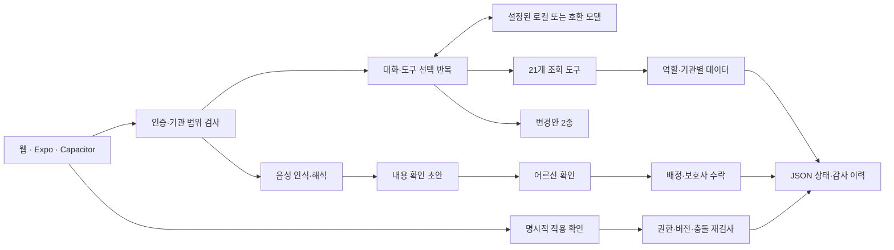

# 돌봄 비서와 조회 도구

직원은 ‘돌봄 비서’에서 대화하거나 ‘업무 조회 · 변경’ 메뉴로 도구를 직접 실행한다. 도구는 `lib/agent-tools.mjs`의 스키마로 등록하며 서버가 인자, 역할, 기관 범위를 검증한다. 모델이 보낸 기관 ID로 조회 범위를 넓힐 수 없다. 관리자 전용 기능은 사회복지사에게 제공하지 않는다.

요양보호사도 시간표 옆 ‘돌봄 비서’에서 이용할 수 있다. 보호사에게는 본인 요청·시간표·근무, 담당 어르신 상세·안부·출석, 본인 업무 통계·보고서, 내 계정·연결 상태·주소 검색의 14개 조회와 본인 근무 변경안 1개를 제공한다. 담당 어르신이라도 다른 보호사에게 배정된 요청은 보여주지 않는다. 계정 승인·기관 관리·알림 관리·녹음·배정 후보·일정 재배정 도구는 보호사에게 제공하지 않는다. 근무 변경은 사용자 확인 후 적용하며 기존 예약을 유지한다. 모델 미설정 시 제한된 기본 조회와 직접 조회 메뉴를 사용할 수 있다.

## 조회 기능 대응표

| 조회 대상 | 도구 |
|---|---|
| 요청 목록·상태·기간·검색 | `list_requests` |
| 요청 상세·처리 이력·확인·변경 요청 | `get_request` |
| 어르신 목록·특이 사항 필터 | `list_elders` |
| 어르신 상세·주의 사항 | `get_elder` |
| 보호사 목록·가능 서비스 | `list_caregivers` |
| 보호사 상세·근무 설정 | `get_caregiver` |
| 주간·기간·담당자별 시간표 | `get_schedule` |
| 안부 응답·담당자 처리 이력 | `list_checkins` |
| 한국 날짜별 출석 | `list_attendance` |
| 기관 안부 설정 | `get_wellness_settings` |
| 알림 발송 상태·이력 | `list_notifications` |
| 알림 기기·권한 상태 | `list_devices` |
| 직원 가입 승인 목록 (관리자) | `list_approvals` |
| 기관·구성원 수 | `list_organizations` |
| 현재 계정·역할·소속 | `get_account` |
| 서비스 연결 설정 여부 | `get_connections` |
| 일정 조율 후보 | `find_available_caregivers` |
| 요청 녹음 재생 정보 | `get_recording` |
| 전체 원본 집계 | `get_statistics` |
| 기간 보고서·근거 요청 ID | `get_report` |
| 실제 주소 검색 | `search_address` |

총 21개 조회 도구다. 페이지 조회는 기본 50개, 최대 100개이며 `total`은 전체 조건 일치 건수다. 통계·보고서는 페이지 크기로 집계를 제한하지 않는다. 요청·통계의 기간은 **접수일**, 시간표는 **방문일** 기준이다. 연결 설정 조회는 실제 서비스 건강 상태 검사가 아니다. 기기 토큰·계정 비밀번호·인증 비밀값은 도구 결과에 포함하지 않는다.

## 변경 도구

`propose_schedule_change`, `propose_work_hours`는 변경안만 생성한다. 확인 버튼을 누를 때 서버가 소유 세션·권한·10분 만료·대상 변경 여부·일정 충돌을 다시 검사한다. 중복 확인은 한 번만 적용한다. 일정 변경은 보호사에게 재신청되며 수락해야 확정된다. 근무 시간 변경은 기존 예약을 유지한다. 적용 이력은 `agentAudit`에 남는다.

## 모델 연결과 동작

기본은 기존 `OLLAMA_URL`, `OLLAMA_MODEL`을 재사용한다. `AGENT_MODEL`로 비서 모델만 분리할 수 있다. `AGENT_PROVIDER=openai-compatible`를 선택하면 `AGENT_BASE_URL`, `AGENT_MODEL`, 필요시 `AGENT_API_KEY`를 설정한다. 특정 클라우드 SDK나 Bedrock AgentCore를 연결한 구현은 아니다.

모델은 등록된 도구를 선택하고 결과를 받은 후 추가 도구 또는 최종 답변을 결정한다. 최대 5회, 회당 3개 도구, 모델 호출당 45초로 제한한다. 변경안을 만들면 사용자의 확인을 기다린다. 대화는 서버 메모리에 최대 1시간 유지되며 계정·역할·기관·세션에 종속된다. 모델 미설정 상태는 ‘기본 조회 모드’로 표시하고 제한된 키워드 조회와 전체 도구 메뉴를 제공한다. 설정된 모델의 실패를 성공한 대화로 위장하지 않는다.

## 아키텍처

현재 저장소는 단일 프로세스 JSON 저장 방식이다. 다중 서버 운영에 필요한 공유 DB·분산 작업 큐·기관별 관리자 계층 전체는 별도 운영 설계 대상이다. 모델 공급자·보관 기간·배정 거절 기준·이동 여유의 최종 운영값은 회의에서 확정되지 않았으므로 임의로 확정하지 않았다.
